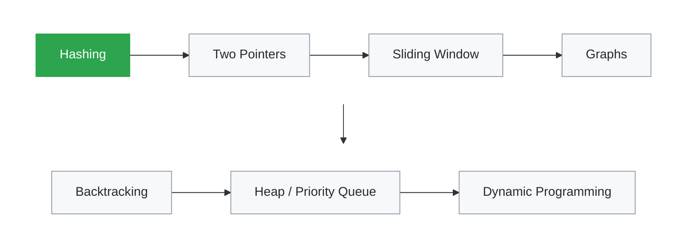

# Java DSA Patterns

Data Structures & Algorithms problems solved in **Java**, organized by **pattern**,
with unit tests and complexity analysis for every solution.

Each solution includes:
- 🔗 Link to the original problem
- 💡 Intuition — a real-world analogy behind the approach
- ⏱️ Time and space complexity
- ✅ JUnit 6 tests

## Roadmap



## Progress

| # | Problem | Pattern | Time | Space | Solution |
|---|---------|---------|------|-------|----------|
| 1 | [Two Sum](https://leetcode.com/problems/two-sum/) | Hashing | O(n) | O(n) | [Java](src/main/java/com/yuvaraj/dsa/hashing/TwoSum.java) |

## Pattern Notes

**Hashing**: Like a hotel reception register. Instead of knocking on every door
to find a guest, you look up the register and get the room number instantly.
Use it when you need O(1) "have I seen this before?" lookups.

## Run the Tests

Uses the bundled Maven Wrapper, so no Maven install is needed:

```bash
./mvnw test
```

## Tech

Java 21 · JUnit 6 · Maven

---
Built by [Yuvaraj](https://www.linkedin.com/in/yuvaraj-k-77207a96) · Senior Java Tech Lead
