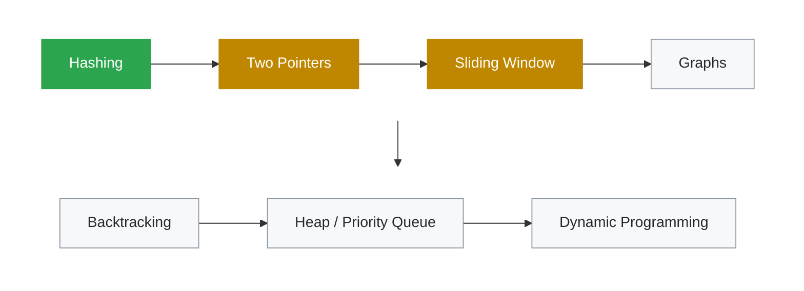

# Java DSA Patterns

[](https://github.com/yuviyashu/java-dsa-patterns/actions/workflows/ci.yml)

Data Structures & Algorithms problems solved in **Java**, organized by **pattern**,
with unit tests and complexity analysis for every solution.

Each solution includes:
- 🔗 Link to the original problem
- 💡 Intuition — a real-world analogy behind the approach
- ⏱️ Time and space complexity
- ✅ JUnit 6 tests

## Roadmap



🟩 Done · 🟨 In progress · ⬜ Next

## Progress

| # | Problem | Pattern | Time | Space | Solution |
|---|---------|---------|------|-------|----------|
| 1 | [Two Sum](https://leetcode.com/problems/two-sum/) | Hashing | O(n) | O(n) | [Java](src/main/java/com/yuvaraj/dsa/hashing/TwoSum.java) |
| 2 | [Contains Duplicate](https://leetcode.com/problems/contains-duplicate/) | Hashing | O(n) | O(n) | [Java](src/main/java/com/yuvaraj/dsa/hashing/ContainsDuplicate.java) |
| 3 | [Group Anagrams](https://leetcode.com/problems/group-anagrams/) | Hashing | O(n·k log k) | O(n·k) | [Java](src/main/java/com/yuvaraj/dsa/hashing/GroupAnagrams.java) |
| 4 | Max Sum Subarray of Size K | Sliding Window | O(n) | O(1) | [Java](src/main/java/com/yuvaraj/dsa/slidingwindow/MaxSumSubarray.java) |
| 5 | [Valid Palindrome](https://leetcode.com/problems/valid-palindrome/) | Two Pointers | O(n) | O(n) | [Java](src/main/java/com/yuvaraj/dsa/twopointers/IsPalindrome.java) |

<sub>n = number of strings, k = length of the longest string</sub>

## Pattern Notes

**Hashing**: Like a hotel reception register. Instead of knocking on every door
to find a guest, you look up the register and get the room number instantly.
Use it when you need O(1) "have I seen this before?" lookups.

**Two Pointers**: Like two people searching a sorted bookshelf from opposite ends
and walking toward each other. Each step safely eliminates options, turning
O(n²) brute force into O(n).

**Sliding Window**: Like a row of chairs with a fixed or flexible frame over it.
Instead of recounting every chair each time, add the one entering the frame and
drop the one leaving. Use it for contiguous subarray/substring problems.

## Run the Tests

Uses the bundled Maven Wrapper, so no Maven install is needed:

```bash
./mvnw test
```

## Tech

Java 21 · JUnit 6 · Maven

---
Built by [Yuvaraj](https://www.linkedin.com/in/yuvaraj-k-77207a96) · Senior Java Tech Lead
